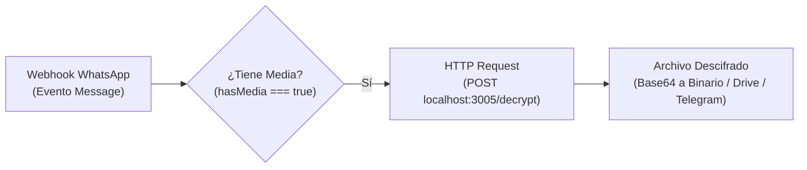

# 🔓 WhatsApp Media Decrypt API

[](https://nodejs.org/)
[](https://expressjs.com/)
[](LICENSE)
[](https://nodejs.org/api/crypto.html)

Microservicio ligero y ultra rápido en **Node.js** diseñado para descargar y descifrar archivos multimedia de WhatsApp (imágenes, audios, videos y documentos) a tamaño real y resolución original, utilizando directamente la URL de la CDN de WhatsApp (`.enc`) y su clave de cifrado (`mediaKey`).

---

## 📌 ¿Qué problema resuelve este proyecto?

Si trabajas con APIs de WhatsApp basadas en Web (como [`whatsapp-web.js`](https://github.com/pedroslopez/whatsapp-web.js), `wwebjs-api`, wrappers de Puppeteer) o integraciones en **n8n**, probablemente te hayas topado con uno o varios de estos problemas:

1. **Miniaturas en lugar de imágenes reales**: En los webhooks de mensajes entrantes (`message`), WhatsApp solo entrega metadatos y una miniatura pequeña de baja resolución (thumbnail de ~300 bytes en `_data.body`). La imagen real sigue cifrada en los servidores de WhatsApp.
2. **Error 500 (`error: "r"`) con cuentas `@lid`**: Las versiones recientes de WhatsApp utilizan identificadores de privacidad **LID** (por ejemplo `123456789012345@lid`). Al llamar a funciones como `downloadMedia()` o buscar chats por `@lid`, WhatsApp Web falla internamente y no encuentra el chat.
3. **Sobrecarga de Puppeteer/Chrome**: Descargar archivos pesados a través del navegador de WhatsApp Web consume mucha memoria RAM, puede bloquear la sesión o provocar caídas del navegador.
4. **Pérdida del evento en Webhooks de n8n**: En flujos de prueba (`webhook-test`), n8n cierra la escucha tras recibir el evento inicial del mensaje, perdiendo el callback posterior de la descarga multimedia.

### 💡 La Solución
Este microservicio desacopla completamente el descifrado del navegador de WhatsApp Web:
* Recibe la **URL del archivo cifrado** (`deprecatedMms3Url` o `directPath`) y la clave **`mediaKey`**.
* Deriva las claves criptográficas con **HKDF-SHA256**.
* Descarga el archivo binario cifrado directamente desde la CDN oficial de WhatsApp (`mmg.whatsapp.net`).
* Lo descifra en memoria con **AES-256-CBC** y retorna la imagen o archivo completo en **Base64** en **menos de 500 ms**.

---

## 🚀 Características

* ⚡ **Ultra Rápido**: Descarga y descifrado en memoria en ~300ms - 500ms.
* 🛡️ **Compatible con `@lid` y Grupos**: Funciona sin importar el tipo de remitente, grupo o canal.
* 📦 **Múltiples Formatos**: Compatible con imágenes (`image`), notas de voz/audios (`audio`), videos (`video`) y documentos (`document`).
* 🪶 **Ligero**: Solo requiere `express`. El descifrado y la descarga utilizan las librerías nativas `crypto` y `https` de Node.js (cero dependencias externas complejas).
* 🔄 **Fácil integración**: Diseñado para conectarse directamente con **n8n**, Make, Node-RED, Postman o cualquier backend.

---

## 🛠️ Instalación y Uso

### 1. Clonar o descargar el repositorio
```bash
git clone https://github.com/tu-usuario/wa-decrypt.git
cd wa-decrypt
```

### 2. Instalar dependencias
```bash
npm install
```

### 3. Iniciar el servidor
```bash
node index.js
```
El servicio quedará escuchando en: `http://localhost:3005`

---

## 📖 Referencia de la API

### Endpoint: `POST /decrypt`

Descarga y descifra un archivo multimedia cifrado de WhatsApp.

#### Request Headers:
```http
Content-Type: application/json
```

#### Request Body (JSON):
| Parámetro | Tipo | Obligatorio | Descripción |
| :--- | :--- | :--- | :--- |
| `url` | `string` | **Sí** | URL del archivo `.enc` en la CDN de WhatsApp (`deprecatedMms3Url` o URL completa con `directPath`). |
| `mediaKey` | `string` | **Sí** | Clave de cifrado en formato Base64 proporcionada por WhatsApp (`message._data.mediaKey`). |
| `type` | `string` | No | Tipo de archivo. Valores permitidos: `image` (por defecto), `video`, `audio`, `document`. |

**Ejemplo de Petición:**
```json
{
  "url": "https://mmg.whatsapp.net/v/t62.7118-24/TU_ARCHIVO_CIFRADO.enc?ccb=11-4&mms3=true",
  "mediaKey": "TU_MEDIA_KEY_EN_BASE64_AQUI==",
  "type": "image"
}
```

#### Response (JSON):
```json
{
  "success": true,
  "size": 10491,
  "base64": "/9j/4AAQSkZJRgABAQAAAQABAAD/2wCE..."
}
```
* `size`: Tamaño real del archivo descifrado en bytes.
* `base64`: Contenido binario del archivo descifrado codificado en Base64.

---

## 🔄 Integración con n8n

Puedes integrar este microservicio en tus flujos de automatización de **n8n** en solo 2 pasos:



### Configuración del nodo HTTP Request en n8n:
1. **Method**: `POST`
2. **URL**: `http://localhost:3005/decrypt` *(o la IP/host de tu servidor)*
3. **Send Body**: Activado (`ON`)
4. **Body Content Type**: `JSON`
5. **Specify Body**: `Using JSON` (en modo **Expression**)
6. **JSON**:
```json
={
  "url": "{{ $json.body.data.message._data.deprecatedMms3Url }}",
  "mediaKey": "{{ $json.body.data.message._data.mediaKey }}",
  "type": "{{ $json.body.data.message._data.type }}"
}
```

> **Tip en n8n:** Si deseas convertir el string `base64` resultante en un archivo binario dentro de n8n para enviarlo a Google Drive o Telegram, puedes usar un nodo **Code (JavaScript)** con:
> ```javascript
> const binaryData = Buffer.from($json.base64, 'base64');
> return [{
>   json: { size: $json.size },
>   binary: {
>     data: {
>       data: $json.base64,
>       mimeType: 'image/jpeg',
>       fileName: 'imagen.jpg'
>     }
>   }
> }];
> ```

---

## 🔐 ¿Cómo funciona la Criptografía de WhatsApp?

WhatsApp utiliza criptografía simétrica para sus archivos multimedia:

1. **Material de Clave (HKDF)**:  
   La `mediaKey` de 32 bytes se expande usando **HKDF con SHA-256** y una etiqueta (*info string*) específica para cada tipo de contenido:
   * Imágenes: `"WhatsApp Image Keys"`
   * Videos: `"WhatsApp Video Keys"`
   * Audios: `"WhatsApp Audio Keys"`
   * Documentos: `"WhatsApp Document Keys"`
2. **Derivación de Claves**:  
   De los 112 bytes derivados:
   * Bytes `0` a `15`: Vector de Inicialización (`iv`) de 16 bytes.
   * Bytes `16` a `47`: Clave de cifrado simétrico (`cipherKey`) de 32 bytes (AES-256).
   * Bytes `48` a `79`: Clave de autenticación MAC.
3. **Descifrado**:  
   Se descarga el archivo cifrado desde la CDN de WhatsApp. Los últimos 10 bytes corresponden al MAC de verificación. El resto del archivo se descifra mediante el algoritmo **AES-256-CBC** usando el `cipherKey` y el `iv`, obteniendo el archivo original sin alteraciones.

---

## 📄 Licencia

Este proyecto está bajo la Licencia **MIT**. Consulta el archivo [LICENSE](LICENSE) para más detalles.
